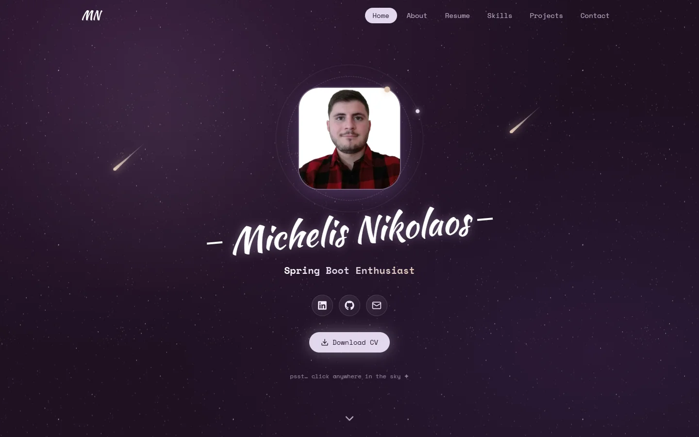

# CV Webpage — Michelis Nikolaos

An interactive, space-themed CV site — starfield, shooting stars and every skill backed by the project or role it came from.

**🌐 Live: [nikos-michelis.github.io](https://nikos-michelis.github.io/)**




## ✨ Features

- **Living background** — tiled starfield with mouse & scroll parallax, falling comets, and shooting stars launched wherever you click.
- **Skills with proof** — animated rings per skill; open one to see *how* it was gained, linked to the exact projects, jobs and degrees.
- **Interactive timeline** — work and education tabs; each entry opens a modal with role details, highlights and the skills used there.
- **Project gallery** — tilt cards with status badges; modals with a swipeable image slider and full-screen lightbox.
- **Contact form** — validation, spam honeypot, and direct sending via Formspree (falls back to the visitor's email app).
- **Accessible & responsive** — keyboard-friendly dialogs, `prefers-reduced-motion` support, mobile-first layout.

## 🛠️ Tech stack

| Area | Tools |
| --- | --- |
| Framework | React 19, TypeScript 6, Vite 8 |
| Styling | Tailwind CSS 4, shadcn/ui (Base UI), Space Mono & Kaushan Script |
| Animation | Motion (Framer Motion), Embla Carousel |
| Icons | lucide-react, react-icons |
| Tooling | oxlint, GitHub Actions → GitHub Pages |

All dependency versions are pinned exactly (`.npmrc` → `save-exact=true`); workflow actions are pinned to commit SHAs.

## 🚀 Getting started

**Requires** Node.js **22.12+** (CI builds with Node 24).

```bash
git clone https://github.com/Nikos-Michelis/nikos-michelis.github.io.git
cd nikos-michelis.github.io
npm ci
npm run dev        # http://localhost:5173
```

| Script | What it does |
| --- | --- |
| `npm run dev` | Start the dev server with hot reload |
| `npm run build` | Type-check and build the production site into `dist/` |
| `npm run preview` | Serve the `dist/` build locally |
| `npm run lint` | Lint with oxlint |

## 📁 Project structure

```
public/assets/              # images, referenced with asset("folder/file.png")
├── companies/              # employer logos
├── education/              # university logos
├── projects/<project>/     # cover + gallery images, one folder per project
├── skills/                 # skill logos without an icon (e.g. Jakarta EE)
├── profile/                # profile photo
└── decorators/             # star background

src/
├── data/                   # ✏️ all CV content — edit these to update the site
├── types/cv.ts             # data shapes (Profile, TimelineEntry, Skill, Project…)
├── services/cv-service.ts  # the only place that knows where data comes from
├── hooks/                  # useCv.ts (data) + reusable behaviour (useTilt, useContactForm…), camelCase file names
├── components/             # page sections, modals and shared pieces
│   └── ui/                 # shadcn/ui components
├── config/                 # icon registry, navigation, contact endpoint
└── index.css               # theme colours, fonts, starfield & comets
```

Components never import `src/data` directly. To load content from an API or JSON file later,
only the getters in `cv-service.ts` change — e.g. `fetchJson<Project[]>("/api/projects")`.

## ✏️ Updating content

| I want to… | Edit |
| --- | --- |
| Change name, bio, links | `src/data/profile.ts` |
| Add a job or degree | `src/data/experience.ts` / `src/data/education.ts` — optional `highlights`, `location`, `duration`… fill the modal |
| Add a skill | `src/data/skills.ts` — new icon? register it in `src/config/icons.ts` |
| Prove a skill | add `{ ref, detail }` to the skill's `proof`; `ref` is a project, job or degree `id` |
| Add a project | `src/data/projects.ts` — images in `public/assets/projects/<id>/`, set `status` |
| Change colours | the `:root` tokens at the top of `src/index.css` |
| Add a page section | new component → `src/App.tsx` + `src/config/navigation.ts` |

## 📬 Contact form

Works out of the box by opening the visitor's email app. To receive messages directly:

1. Create a free form at [formspree.io](https://formspree.io).
2. Copy `.env.example` to `.env` (git-ignored) and set `VITE_CONTACT_FORM_ENDPOINT` to its endpoint.
3. Restart `npm run dev`.

The endpoint is public by design — it only lets people *send* you messages — so it doesn't need to be a secret.

## 🚢 Deployment

Every push to `main` builds and deploys the site with [`.github/workflows/deploy.yml`](.github/workflows/deploy.yml).

One-time repo setup:

1. **Settings → Pages → Source:** `GitHub Actions`
2. **Settings → Secrets and variables → Actions → Variables:** add `VITE_CONTACT_FORM_ENDPOINT` (optional)

The workflow can also be run manually from the **Actions** tab.
